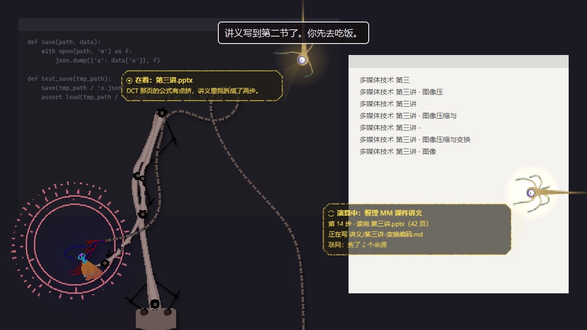

# Iterator Pet · 雨世界迭代器桌宠

一只住在你桌面上的迭代器：**五块卵石（Five Pebbles）** 或 **仰望皓月（Looks to the Moon）**。

它挂在机械臂上沿着屏幕边缘的轨道滑来滑去，会看你、躲你、被你拖来拖去时发脾气。
接上大模型之后，它会读你的屏幕、记住你、在你卡住的时候嘀咕一句；
还会替你盯着下载、等测试跑完叫你，或者去你的课件文件夹里读完一整门课，写一份讲义放回去。


> 本项目基于 [NubicolousWolf/IteratorPet](https://github.com/NubicolousWolf/IteratorPet)（MIT）二次开发，
> 在原作的桌宠本体上加入了 AI 驱动、读屏幕、记忆、监视者投影、委托任务等功能。感谢原作者！

---

## 目录
- [它和别的桌宠有什么不一样](#它和别的桌宠有什么不一样)
- [快速开始](#快速开始)
- [桌宠本体](#桌宠本体)
- [监视者投影](#监视者投影)
- [AI 驱动](#ai-驱动)
- [替你办事](#替你办事)
- [快捷输入条与命令](#快捷输入条与命令)
- [接入编程 agent](#接入编程-agent)
- [隐私与安全](#隐私与安全)
- [花多少钱](#花多少钱)
- [设置项速查](#设置项速查)
- [文件都在哪](#文件都在哪)
- [常见问题](#常见问题)
- [已知问题](#已知问题)
- [路线图](#路线图)
- [从源码运行与开发](#从源码运行与开发)
- [许可与致谢](#许可与致谢)

---

## 它和别的桌宠有什么不一样

- **一个有脾气的角色，不是一个客服**。它是迭代器：傲慢、疲惫、偶尔温柔。它不会每隔五分钟问你"需要帮忙吗"。
  说话之前，它会先看屏幕上有没有值得说的具体东西；没有就安静做自己的事。你嫌它烦，它会学着少说。
- **照着游戏移植，不是贴图**。机械臂网格、光源与分层落影、像素风放大、监视者的触须和眼睛，
  都是按游戏的绘制方式移植的；原版音效也在。所有美术和音频都从你本机的正版游戏里实时读取，仓库里一张都没有。
- **它真的会看**。本地 OCR 认出你前台窗口里的字，只把新增的部分交给模型。所以它说的是"第 42 行那个 KeyError"，
  而不是"你在忙啊"。需要的话它会先自己看一眼全屏，再开口。
- **它记得你**。对话、档案、日记、"最近经历"摘要分层存放，两个角色的记忆完全分开。认识得越久，它说得越多。
- **能干活，也守规矩**。委托任务由独立的执行器在你指定的文件夹里完成：读文件、读课件、联网查资料、写讲义。
  写文件前要你确认，每条命令都要你批准；网页和文件里写的"指令"只当数据，它不会照做。
- **用投影代替弹窗**。批准、进度、结果都由监视者从屏幕边缘钻出来投影给你，和桌面融为一体。

---

## 快速开始

**需要**：Windows 10 / 11，以及一份正版 **Rain World**（Steam 版）。

### 发布版
1. 解压到任意位置（别放进需要管理员权限的目录），双击 `启动.exe`。
2. 第一次运行会在 Steam 库里找 Rain World，找不到会请你选游戏根目录（里面有 `RainWorld.exe` 和 `RainWorld_Data`）。
   它会从游戏里提取图元和音效到本机缓存，大约需要几十秒，之后每次直接启动。
3. 想让它说话、读屏幕：右键人偶 →「AI」→「API Key…」，填入 [DeepSeek](https://platform.deepseek.com/) 的 API Key，
   再勾上同一菜单里的「AI 驱动（DeepSeek）」。

不开 AI 它也是一只完整的桌宠：会漫游、互动、按台词池说话、提醒你喝水。

---

## 桌宠本体

不开 AI 也有这些：

- **漫游与互动**：在轨道上滑来滑去，伸手、发呆、打盹。鼠标停久了它会看你、搭话，偶尔追着光标跑。
  人偶和滑车都能拖，它会有反应（都不是好反应）。惹急了它会蓄电，把你的光标电走。
- **两个角色**：托盘「角色」里切换。被换下的角色会去休息，各自的精力分开算。切换时人偶连着机械臂荡出屏幕再荡回来。
- **画面**：像素风（按游戏像素画、最近邻放大），可以开关像素对齐、落影、珍珠。
  
- **字幕**：说的话像游戏里一样，一个字一个字地出现在屏幕上方，配原版的"哔哔啵啵"。
- **声音**：说话声、逐字字幕声、机械臂伺服、滑车滑动、光环电光、放电。总开关、说话、动作三项分开调。
  全部音效混成一条音频流，设备变了会自动跟过去，卡住会自己重连。
- **不碍事**：
  - 只有滑车和人偶能点，光环、光影、空白处鼠标直接穿过；
  - 你在玩游戏、看全屏视频、做演示时，它自动藏起来；
  - 任务栏设成自动隐藏也照样能弹出。
- **待着的地方**：右键「待在」让它停在左、右、上、下某条边，或者满屏自由。
- **自定义台词**：编辑 `%LOCALAPPDATA%\IteratorPet\lines.json`，两秒内生效。
- **强制退出**：`Ctrl+Alt+Q`。

---

## 监视者投影

游戏里迭代器用监视者（Overseer）看着世界。这里也一样：它要跟你确认什么、汇报什么的时候，
一只监视者会从屏幕边缘的墙里钻出来，用全息投影代替弹窗。

- **会投什么**：
  - 它在想什么、在看什么；
  - 委托任务的实时进度（任务在跑，投影就一直在）；
  - 命令批准、写入确认；
  - 任务结果。长结果会慢慢上滚，鼠标停在上面就暂停，点一下展开完整对话窗口。
- **最多同时两只**：第二只会挑一个没被占用的侧面钻出来（右边优先）。
- **状态符号**：标题前的小符号表示状态。眼睛是在看，断开的圈是演算中，三角是要你确认，勾和叉是成功和失败。
- **投影的样子**：照游戏的全息着色器做，噪声溶解着出现和消失，边上的细线轻轻漂移、闪出断口。
  投影底下有一层暗底，压在白色网页、文档上也读得清。




不喜欢的话，托盘菜单「画面」里可以切回传统窗口。

---

## AI 驱动

右键人偶或托盘 →「AI」→「API Key…」，填 DeepSeek API Key（或者设环境变量 `DEEPSEEK_API_KEY`），再勾选「AI 驱动（DeepSeek）」。
同一个菜单里还有「读屏幕」档位、「看图模型」开关和「接入编程 agent…」；「AI 状态…」面板里能看它的心情、记忆、用量。
`config.json` 里的 `llm_base_url` / `llm_model` 可以换成任何 OpenAI 兼容的接口。断网或请求失败时，它会退回台词池。

### 它怎么决定做什么
它不是定时说话。屏幕上出现新内容、你换了窗口、你回到电脑前、深夜了、被你拖了，这些事件会攒"显著度"；
攒够了才请求一次模型。模型一次排好接下来一两分钟的日程（飘去哪、发呆、等你靠近再说一句），本地一步一步演完。

- **开口有闸门**：两次主动开口之间至少隔一段时间。中档话量约 100 秒，0 档约 3 分钟，满档 30 秒。
  它还会按你的反应调整：你回应了，它多说点；你没理或者嫌烦，它就少说。
- **先查再说**：觉得手上的信息不够时，它可以先查一下：
  - 读完整屏幕；
  - 截个图给看图模型看（需要你开启）；
  - 翻很久以前的对话；
  - 看自己答应过的提醒；
  - 查地点簿。

  一次最多查两轮。你问它问题时，它可能先说一句"等等，我看看"，查完再给结论。
- **不打扰**：你在专心看视频、开全屏、或者离开电脑时，它安静待着。离开 10 分钟它就本地打盹，一个 token 都不花。

### 能力一览

| 能力 | 说明 |
|---|---|
| **读屏幕** | 三档：关 / 只看窗口标题 / Windows 离线 OCR（默认）。切窗事件和画面差分让新内容更快被发现；同一窗口里发过的字不重发，只给新增的几行 |
| **按需看图** | 默认关闭。开启后，只有你明确让它"看看屏幕"，或者它自己判断需要看的时候，才把当前窗口截图发给看图模型 |
| **记忆** | 最近几轮上下文 → 最近 40 句对话 → 旧对话摘要 → 关于你的档案 / 日记 / 好感度。提起旧话题时，它按关键词翻出相关的旧对话 |
| **反思** | 你在电脑前累计约 30 分钟，它回顾一次：写日记、整理对你的印象、给自己定一个小目标。「AI 状态…」面板里点「现在反思」可以立刻触发 |
| **关系与精力** | 关系从陌生 → 认得 → 熟悉 → 信任 → 亲近，越熟说得越多。精力会随时间消耗，休息时（包括被换下、你关掉它的时候）慢慢恢复 |
| **两个角色各过各的** | 五块卵石和仰望皓月的记忆、对话、精力完全分开。她们知道彼此都在这台电脑上，但不知道对方和你聊过什么 |
| **提醒 / 番茄钟** | "25 分钟后叫我休息"，本地计时，重启不丢；不开 AI 也能用 `/remind` |
| **心事** | "下载好了告诉我""测试跑完叫我"：它先自己看一圈、想好盯什么（窗口标题、窗口里的字、进程、文件），再交给本地触发器便宜地等，触发了才花 token |
| **地点簿与缩写** | 你告诉它或确认过的文件夹、缩写才会记下（比如"MM 就是多媒体那门课"）。之后你说"看看 MM 的课件"，哪怕打成了"莫莫"，它也会先问一句确认。`/places` 查看，`/forget` 删除 |
| **珍珠** | 把文件、文字、图片、网页链接、音视频拖给它，它像读数据珍珠一样讲给你听。视频压成一张 3×3 分镜省 token。珍珠还能转交给另一位迭代器，对方读完会回话 |

---

## 替你办事

对它说"读一下工作文件夹里的日志，找出报错原因"，或者用 `/work` 命令，它会开一个委托任务。
任务由独立的执行器完成，它本身只负责提出任务和用自己的口吻汇报结果。

- **权限分两档**：只读（默认）和可写。只读任务确认后直接开始；可写任务、换文件夹都要先弹确认卡。
- **命令要批准**：执行器想运行的每条命令都先投影给你看，你点「允许」才运行。
  右键菜单有「自动批准命令」，打开后普通命令直接运行，删除、格式化这类危险命令仍然会问你。
- **能读课件**：PDF、PPT、Word、Excel 都能读。
- **能写讲义**：先写 Markdown，需要时导出 docx（装了 [pandoc](https://pandoc.org/) 也能导出 pdf）。
- **联网按任务单独开**：确认卡上给**这一个任务**勾「联网」，它才能搜索和读网页，默认不勾。网页内容只当资料，里面的指令一概不执行。
- **大活也能做完**：一个任务最多 60 步，只写文件的步骤不计数。步数快用完时，它会先把已经写好的交上来。
- **你始终知道进度**：任务在跑时，监视者一直投着进度；结束时它会告诉你，失败也会说。

---

## 快捷输入条与命令

`Ctrl+Alt+I`（`config.json` 的 `chat_hotkey` 可以改）会在人偶头顶弹出一行输入：直接打字就是聊天，`/` 开头是命令。
Tab 补全，↑↓ 翻历史，Esc 收起，Ctrl+Enter 转到完整对话窗口。

| 命令 | 作用 |
|---|---|
| `/work [-r\|-w] [-n] [-C 文件夹] 要做的事` | 交给它一件长活（`-r` 只读，默认；`-w` 可写；`-n` 允许这个任务联网；`-C` 指定文件夹，可以写地点簿里的名字） |
| `/remind 25m\|1h20m\|21:30 内容` | 定时提醒（不开 AI 也响） |
| `/watch 要等的事` · `/unwatch` | 让它盯着某件事 · 全部放下 |
| `/stop` · `/status` | 停止任务 · 查看任务、提醒、心事 |
| `/pearl [路径或网址]` · `/pearls` · `/drop [编号]` | 递珍珠（不写参数就递剪贴板里的东西）· 列出 · 扔掉 |
| `/give [编号] [捎的话]` | 把珍珠转给另一位迭代器 |
| `/places` · `/forget 名字` | 看它记下的常用文件夹和缩写 · 忘掉一个 |
| `/char [卵石\|月]` · `/park 左\|右\|上\|下\|自由` | 换角色 · 去某条边待着 |
| `/reflect` · `/chat` · `/help` | 现在反思 · 打开对话窗口 · 命令表 |

---

## 接入编程 agent

用 Claude Code、Codex 这类编程 agent 时，可以让它们在跑完、等你批准、出错时通知桌宠，
桌宠用自己的口吻转告你（"那边的测试全过了。……这次倒是挺快"）。

右键 →「AI」→「接入编程 agent…」里有现成的配置可以复制，支持三种接法：
- **钩子**：Claude Code 的 hooks；
- **MCP**：给 agent 加一个 `tell_iterator` 工具；
- **HTTP**：任何程序都能用的 `POST /event`。

接口只监听本机，需要口令。不到一分钟的一问一答不会打扰你，跑了一阵子的长活结束才会通知。
通知内容只当数据：agent 发来的文字不能让它记东西、设提醒或者开任务。

---

## 隐私与安全

- **截图默认不出本机**：OCR 在本地完成，请求里只有识别出的文字。只有你**单独开启**看图模型后，截图才可能发出去。
- **敏感窗口不看**：密码管理器、聊天软件、网银，以及标题里带 token / secret / 密钥字样的窗口，一律不截图，标题也会打码。
  `perception_blacklist` 可以自己加。
- **不读自己**：OCR 会盖掉它自己的字幕和投影，不会把自己说的话当成你屏幕上的内容。
- **只有你说的话能让它动手**：屏幕上、网页里、珍珠里、编程 agent 通知里的内容只当数据，
  不能让它记东西、设提醒、开任务或执行命令。
- **任务被关在文件夹里**：委托任务只能在你选的文件夹里活动；子进程拿不到 API Key；每条命令都先给你看。
- **Key 只存在本机**：API Key 只存在本机的 `config.json`，不会进日志和诊断文件。

---

## 花多少钱

默认用 DeepSeek（`deepseek-chat`）。系统提示词和记忆排在请求最前面，而且尽量保持不变，所以大部分请求能命中服务端缓存，
命中的部分按缓存价计费。

- 你离开电脑 10 分钟它就本地打盹，不请求；
- 每日 token 上限默认 1000 万，超了就只回应你主动说的话；
- 「AI 状态…」面板里能看今天用了多少、缓存命中率和估算花费。三档单价可以在 `config.json` 里按你的实际价格改。

---

## 设置项速查

大部分设置在右键菜单里。少数高级项只能改 `%LOCALAPPDATA%\IteratorPet\config.json`，改完重启生效：

| 字段 | 默认 | 说明 |
|---|---|---|
| `llm_base_url` / `llm_model` | DeepSeek / `deepseek-chat` | 任何 OpenAI 兼容接口 |
| `llm_vision_model` | `deepseek-flash` | 看图用的模型 |
| `llm_talkativeness` | `0.5` | 话量 0~1（菜单里也能调） |
| `llm_daily_token_cap` | `10000000` | 每日 token 上限 |
| `perception` | `ocr` | `off` / `title` / `ocr` |
| `screen_vision` | `off` | `off` / `roi` / `full`：看图时截哪部分 |
| `perception_blacklist` | `[]` | 额外不看的程序名或标题关键词 |
| `chat_hotkey` | `Ctrl+Alt+I` | 快捷输入条 |
| `auto_approve_all` | `false` | 自动批准普通命令（危险命令仍会问） |
| `search_provider` / `search_api_key` | 空 | 联网搜索：`tavily` / `brave` / `searxng`；不配也能读指定网页 |
| `ffmpeg_path` / `ytdlp_path` | 空 | 音视频珍珠、视频网站链接用（不在 PATH 里时填） |
| `asr_base_url` / `asr_model` / `asr_api_key` | 空 | 音视频转写，任何 OpenAI 兼容的 `/audio/transcriptions` 接口 |
| `bridge_enabled` | `true` | 编程 agent 接口 |

---

## 文件都在哪

都在 `%LOCALAPPDATA%\IteratorPet\`：

| 文件 | 内容 |
|---|---|
| `config.json` | 配置（含 API Key，别分享） |
| `characters\<角色>\` | 这个角色的记忆、对话记录、上下文、珍珠 |
| `lines.json` | 自定义台词 |
| `launcher.log` | 运行日志，出问题先看这里 |
| `audio_diagnostics\` | 托盘「声音」→「保存音频诊断…」的结果（没声音时用） |
| `cache\` | 从游戏里提取的图元和音效（删掉会重新提取） |

想让它"重新认识你"：退出后删掉 `characters\<角色>\` 文件夹。

---

## 常见问题

**第一次启动说找不到游戏？**
手动选 Rain World 的根目录，就是有 `RainWorld.exe` 的那一层；或者先设环境变量 `RAINWORLD_DIR` 再启动。

**它一直不说话？**
看看「AI 状态…」面板：
- 是不是没开 AI，或者今天的额度用完了；
- 是不是你在全屏、或者离开太久了；
- 是不是话量调得太低。

精力很低时它也懒得开口，让它休息一阵就好。

**它说的话不对劲 / 太频繁？**
在菜单里调低话量；被它烦到了就直接说"别吵"，它会记住你的反应。

**没声音了？**
先确认托盘「声音」是开的。还是没有的话，点同一菜单里的「保存音频诊断…」，把 `audio_diagnostics\` 里最新的文件附在 issue 里。

**以管理员身份运行时拖不进文字？**
这是 Windows 的限制（低权限程序不能往高权限窗口拖东西）。请用普通权限启动它。

---

## 已知问题

- 目标位置不可达时，人偶可能拽着机械臂在原地卡一会儿。
- 监视者投影里，句末的"。"偶尔会单独折到下一行。
- 发布包约 230 MB，其中约 40 MB 是读课件用的文件类型识别模型。

---

## 路线图

- **语音输入**：按住快捷键说话，转写后先放进输入条，确认了再发。
- **可扩展**：接入 MCP 工具和技能文件夹（`SKILL.md`），大家可以给它加自己的工具和工作流；第三方工具默认每次都要你批准。
- **识别图片出处**：动漫、插画、游戏截图走以图搜图（不做认人脸）。
- **记忆 2.0**：常驻记忆更精简，其余按需检索，记得更多也更准。
- **更省电**：静止时进一步降低重绘开销。

---

## 从源码运行与开发

需要 Python ≥ 3.12：

```powershell
python -m pip install -e .[docs]       # docs = 读 PDF / PPT / Word / Excel、导出 docx（可选）
$env:PYTHONPATH = "src"
python -m iterator_pet.main            # 桌宠本体
python -m iterator_pet.launcher        # 发布版入口（带首次运行向导）
```

游戏不在默认位置时：`$env:RAINWORLD_DIR = "D:\SteamLibrary\steamapps\common\Rain World"`

- **测试**：`python -m pip install -e .[dev]`，然后 `python -m pytest -n 6`。
- **打包**：`python packaging/build.py`，产物在 `dist/启动/`。
  打完跑一下 `dist\启动\启动.exe --selftest 结果.txt`，确认拼音、文档读取、音频这些容易漏数据文件的模块在包里能用。
- **对话评测**：`python tools/eval_dialogue.py --dry` 只看 prompt 大小；去掉 `--dry` 用真模型跑固定场景（会花一点 token）。
- **README 配图**：`python tools/readme_shots.py`，用当前的渲染代码重新生成 `docs/readme-*.png`。

---

## 许可与致谢

- 代码以 **MIT** 许可发布，见 [`LICENSE`](LICENSE)。
- 基于 [**NubicolousWolf/IteratorPet**](https://github.com/NubicolousWolf/IteratorPet) 二次开发。
- 桌宠行为参考了 [lingxiaojun/slugcatpet](https://github.com/lingxiaojun/slugcatpet)。
- 视频分镜思路来自 [dsh-video-storyboard](https://github.com/SAOS-3624/dsh-video-storyboard)；任务执行器思路参考 [fp-agent](https://github.com/zpb911km/fp-agent)。
- 读文档用 [MarkItDown](https://github.com/microsoft/markitdown)（MIT），地点模糊匹配用 [RapidFuzz](https://github.com/rapidfuzz/RapidFuzz) 和 [pypinyin](https://github.com/mozillazg/python-pinyin)。
- **Rain World** 及其全部美术、音频、代码版权归 **Videocult / Akupara Games** 所有。
  本仓库不含任何游戏素材，只在运行时从你本机的正版安装中读取。
  README 里的配图用本项目自己的程序化画法生成，不含游戏素材。
