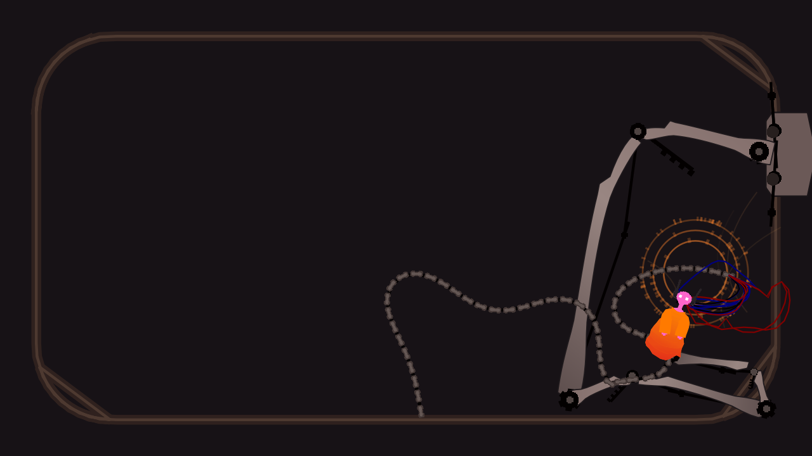
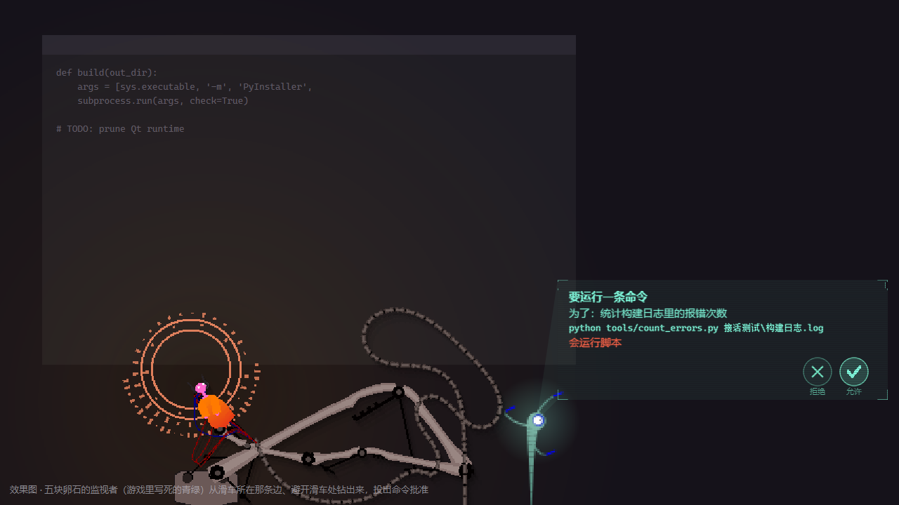

# Iterator Pet · 雨世界迭代器桌宠

一只住在你桌面上的迭代器——**五块卵石（Five Pebbles）** 和 **仰望皓月（Looks to the Moon）**。
它会漫游、看你、被你拖来拖去时发脾气；接上 DeepSeek 之后，还会读屏幕、记住你、替你盯着下载、帮你读文件。



> 本项目基于 [NubicolousWolf/IteratorPet](https://github.com/NubicolousWolf/IteratorPet)（MIT）二次开发，
> 在其桌宠本体之上加入了 AI 驱动、读屏幕、记忆、监视者投影等功能。感谢原作者！

---

## 目录
- [快速开始](#快速开始)
- [功能一览](#功能一览)
- [AI 驱动](#ai-驱动)
- [快捷输入条与命令](#快捷输入条与命令)
- [隐私](#隐私)
- [文件都在哪](#文件都在哪)
- [已知问题](#已知问题)
- [路线图](#路线图)
- [许可与致谢](#许可与致谢)

---

## 快速开始

**需要**：Windows 10/11，以及一份正版 **Rain World**（图元和音效在运行时从你本机的游戏里读取，本仓库不含任何游戏素材）。

### 发布版
解压后双击 `启动.exe`。
- 第一次运行会自动在 Steam 库里找 Rain World，找不到会请你指到游戏根目录（里面有 `RainWorld.exe` 和 `RainWorld_Data`）。
- 之后每次直接启动；缓存缺了才重新提取。

### 从源码运行（Python ≥ 3.12）
```powershell
python -m pip install -r requirements.txt
$env:PYTHONPATH = "src"
python -m iterator_pet.main        # 桌宠本体
python -m iterator_pet.launcher    # 发布版入口（带首次运行向导）
```

游戏不在默认位置时可以指定：
```powershell
$env:RAINWORLD_DIR = "D:\SteamLibrary\steamapps\common\Rain World"
```

---

## 功能一览

### 桌宠本体（不开 AI 也有）
- **漫游与互动**：在屏幕上闲逛；鼠标悬停久了会看你、搭话，偶尔追着光标跑；人偶和底座都能拖，它会有反应（都不是好反应）。
- **两个角色**：托盘「角色」里切换。切换时人偶连着机械臂荡出屏幕再荡回来。
- **画面**：像素风（按游戏像素画、最近邻放大），照原版移植的机械臂网格、光源与分层落影。
  
- **声音**：原版音效——说话的"哔哔啵啵"、逐字字幕的轻响、机械臂伺服、底座滑动、放电。总开关 / 说话 / 动作分开调。
- **不碍事**：只有滑车和人偶能点，光环、光影处鼠标直接穿过；前台全屏（游戏、视频、演示）时自动藏起来。
- **自定义台词**：编辑 `%LOCALAPPDATA%\IteratorPet\lines.json`，两秒内生效。
- **强制退出**：`Ctrl+Alt+Q`。

### 监视者投影（实验性）
照游戏移植的监视者（Overseer）从屏幕边缘钻出来，用全息投影代替弹窗：心情、"它在想"、任务进度、批准请求、长结果滚动。
右键「画面」里切换投影 / 传统窗口。



---

## AI 驱动

右键人偶或托盘 →「AI 设置…」填 DeepSeek API Key（或设环境变量 `DEEPSEEK_API_KEY`），勾选「AI 驱动」。
`config.json` 里的 `llm_base_url` / `llm_model` 可以换成任何 OpenAI 兼容接口。断网或请求失败时自动退回台词池。

| 能力 | 说明 |
|---|---|
| **自主日程** | 模型一次排好接下来几分钟做什么（飘去哪、发呆、等你靠近再说话），本地一步步演；被拖、你回来、换窗口、深夜等事件会叫醒它 |
| **读屏幕** | 三档：关 / 只看窗口标题 / Windows 离线 OCR。切窗事件 + 画面差分让新内容更快被发现，画面稳定时降低识别频率，只把新增的文字交给模型 |
| **按需看图** | 默认关闭。开启后，只有你明确要它"看看屏幕"时，才把当前窗口截图发给看图模型 |
| **记忆** | 最近上下文 → 最近 40 句对话 → 旧对话摘要 → 关于你的档案 / 日记 / 好感度；提起旧话题时按关键词翻出相关对话 |
| **反思** | 你在电脑前约 30 分钟，它回顾一次：写日记、整理对你的印象、给自己定小目标 |
| **关系与性格** | 陌生 → 认得 → 熟悉 → 信任 → 亲近，越熟说得越多；有精力值，累了话就短；会从你的反应里学该多说还是少说 |
| **两个角色各过各的** | 五块卵石和仰望皓月的记忆、对话完全分开；她们知道彼此都在这台电脑上，但不知道对方和你聊过什么 |
| **提醒 / 番茄钟** | "25 分钟后叫我休息"，本地计时，重启不丢 |
| **心事** | "下载好了告诉我""测试跑完叫我"：它先自己规划盯什么，再用本地触发器便宜地等，触发了才花 token |
| **替你办事** | "读一下工作文件夹里的日志，找出报错原因"：只读任务直接开始；要写文件或换文件夹先弹确认卡；每条命令都要你批准 |
| **珍珠** | 把文件、文字、图片、网页链接、音视频拖给它，它像读数据珍珠一样讲给你听；视频压成一张 3×3 分镜省 token；珍珠还能转交给另一位迭代器 |
| **接入编程 agent** | Claude Code / Codex 跑完、等你批准、出错时通知它，它用自己的口吻转告你（钩子 / MCP / HTTP 三种接法，菜单里有可复制的配置） |
| **预算** | 每日 token 上限（默认 1000 万）；你离开 10 分钟它就本地打盹；状态面板里看用量、缓存命中率和估算花费 |

**可选依赖**：视频 / 音频珍珠需要 [ffmpeg](https://ffmpeg.org/)；视频网站链接需要 [yt-dlp](https://github.com/yt-dlp/yt-dlp)；
语音转写可配任何 OpenAI 兼容的 `/audio/transcriptions` 接口（`asr_base_url` / `asr_model` / `asr_api_key`）。

---

## 快捷输入条与命令

`Ctrl+Alt+I`（`config.json` 的 `chat_hotkey` 可改）在人偶头顶弹出一行输入：直接打字就是聊天，`/` 开头是命令。
Tab 补全，↑↓ 翻历史，Esc 收起，Ctrl+Enter 转到完整对话窗口。

| 命令 | 作用 |
|---|---|
| `/work [-r\|-w] [-C 文件夹] 要做的事` | 交给它一件长活（`-r` 只读，默认；`-w` 可写） |
| `/remind 25m\|1h20m\|21:30 内容` | 定时提醒（不开 AI 也响） |
| `/watch 要等的事` · `/unwatch` | 让它盯着某件事 · 全部放下 |
| `/stop` · `/status` | 停止任务 · 查看任务、提醒、心事 |
| `/pearl [路径或网址]` · `/pearls` · `/drop [编号]` | 递珍珠（不写参数就递剪贴板）· 列出 · 扔掉 |
| `/give [编号] [捎的话]` | 把珍珠转给另一位迭代器 |
| `/char [卵石\|月]` · `/park 左\|右\|上\|下\|自由` | 换角色 · 去某条边待着 |
| `/reflect` · `/chat` · `/help` | 现在反思 · 打开对话窗口 · 命令表 |

---

## 隐私

- **截图默认不出本机**：OCR 在本地完成，进请求的只有识别出的文字。
- 只有你**单独开启**看图模型、并**明确要求**它看屏幕时，才会把截图发出去。
- 密码管理器、聊天软件、银行，以及标题带 token / secret / 密钥字样的窗口：不截图、标题打码（`perception_blacklist` 可自定义）。
- 替你办事时只能在你选的文件夹里活动；子进程不带 API Key；每条命令都先给你看。
- 编程 agent、网页、珍珠里的内容只当数据，不能让它记东西、设提醒或发起任务。
- API Key 只存在本机的 `config.json`。

---

## 文件都在哪

都在 `%LOCALAPPDATA%\IteratorPet\`：

| 文件 | 内容 |
|---|---|
| `config.json` | 配置（含 API Key，别分享） |
| `characters\<角色>\` | 该角色的记忆、对话记录、上下文、珍珠 |
| `lines.json` | 自定义台词 |
| `launcher.log` | 运行日志，出问题先看这里 |
| `cache\` | 从游戏里提取的图元和音效 |

---

## 已知问题

- 音效偶尔整体失声，原因尚未查明。
- 目标位置不可达时，人偶可能拽着机械臂卡在原地。
- 以**管理员身份**运行时拖不进文字（文件可以），请用普通权限启动。

---

## 路线图

- 对话中按需调用工具（读屏幕、翻记忆），更自然、更省 token
- 记住常用文件夹和缩写，说"看看 MM 的课件"它就知道在哪
- 联网查资料、读 PDF / PPT，整理成讲义
- 接入 MCP 工具与技能文件夹，方便大家扩展
- 语音输入

---

## 许可与致谢

- 代码以 **MIT** 许可发布，见 [`LICENSE`](LICENSE)。
- 基于 [**NubicolousWolf/IteratorPet**](https://github.com/NubicolousWolf/IteratorPet) 二次开发。
- 桌宠行为参考了 [lingxiaojun/slugcatpet](https://github.com/lingxiaojun/slugcatpet)。
- 视频分镜思路来自 [dsh-video-storyboard](https://github.com/SAOS-3624/dsh-video-storyboard)；任务执行器思路参考 [fp-agent](https://github.com/zpb911km/fp-agent)。
- **Rain World** 及其全部美术、音频、代码版权归 **Videocult / Akupara Games** 所有。本仓库不含任何游戏素材，仅在运行时从你本机的正版安装中读取。
