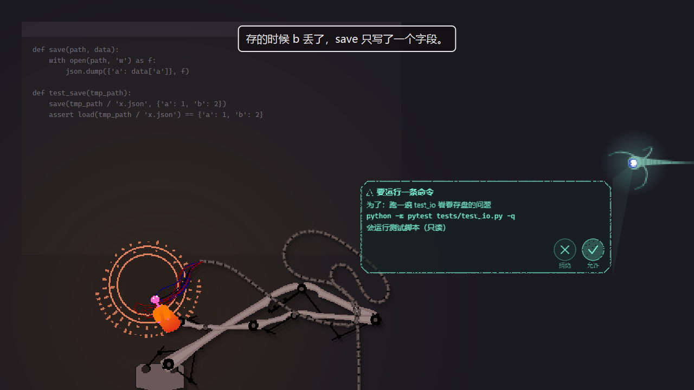
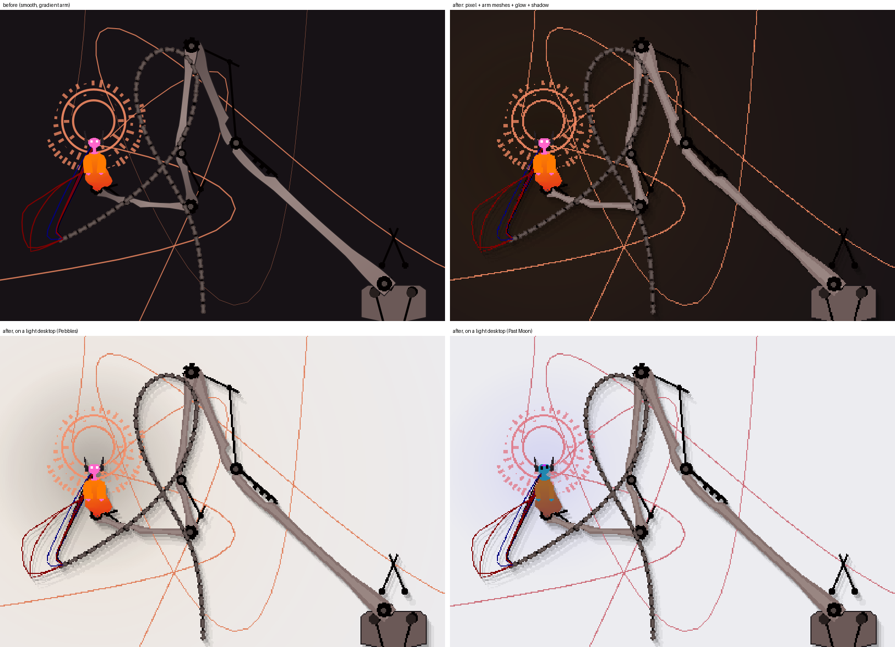

# Iterator Pet · 雨世界迭代器桌宠

**把五块卵石或仰望皓月请到桌面上。机械臂沿屏幕边缘滑动，监视者从墙里探出眼睛，把它想说的话投在你面前。**

它会被你拖得不耐烦，也会在你离开后打盹。接上模型，它开始留意你正在做的事，记住聊过的话，等测试跑完时叫你一声。你还可以把一件小事教成它的习惯，让它以后照着做。



### 桌面上的另一位居民

**角色住在画面里。** 人偶、机械臂、像素光影和原版音效一起构成它的动作；字幕逐字浮现在屏幕上方。批准一条命令、汇报任务进度时，监视者会钻出来投影。五块卵石与仰望皓月各有自己的对话、记忆和精力，换下的那位会去休息。

**它能接上你手头的事。** 比如前台窗口刚出现一段报错，或者你说“下载好了叫我”。读屏幕、等待条件、回顾旧对话给它提供线索；什么时候开口，还受话量、精力和你的反应影响。没有值得说的内容时，它可以安静待着。

**小功能可以聊着教。** “我随口说的想法，帮我记下来，晚上回顾一下。”它把请求写成一份可编辑、可回退的习惯。之后再说“改到睡前”，就能继续调整。习惯和笔记是你电脑上的普通文件；两个角色共用这套工作流。

**能把事情做完，也把过程摊开。** 读课件、整理日志、查资料、写 Markdown 或导出 Word，可以交给委托任务。监视者显示进度，执行命令时提供批准入口。它能接触文件、运行脚本，这也带来实际风险：第一次使用前，请读[隐私与安全](#隐私与安全)。

项目基于 [NubicolousWolf/IteratorPet](https://github.com/NubicolousWolf/IteratorPet)（MIT）二次开发，在桌宠本体上加入 AI、记忆、投影和任务系统。游戏素材只从你本机的正版 Rain World 安装中读取，不随仓库或发布包分发。

## 快速开始

需要 **Windows 10 / 11**。原版外观与音效需要本机安装正版 **Rain World（Steam 版）**。

1. 从本仓库的 Releases 下载并解压发布包，双击 `启动.exe`。用普通用户权限运行，放在不需要管理员权限的目录。
2. 首次启动会查找 Steam 库和注册表，将游戏图元、音效提取到本机缓存。找不到时先使用内置图元；运行 `启动.exe --setup` 可以手动选择含 `RainWorld.exe` 的游戏根目录。
3. 想使用 AI：右键人偶或托盘 →「AI」→「API Key…」，填入自己的 [DeepSeek API Key](https://platform.deepseek.com/)，再开启「AI 驱动」。请求由你配置的模型服务计费。
4. 开始前在「AI」→「读屏幕」选合适的档位。默认 OCR 在本机识字，**识别出的文字会随 AI 请求发送给模型服务**。处理私密内容时请关掉读屏。

不开 AI 也能漫游、互动、按台词池说话，用 `/remind` 做本地提醒。`Ctrl+Alt+I` 打开快捷输入条，`Ctrl+Alt+Q` 退出。

## 人偶、机械臂与监视者

人偶和滑车都能拖动。松手后它会顺着惯性晃动，被惹急了还会蓄电，把光标电走。光环、落影与空白处可穿透鼠标；全屏游戏、视频或演示时自动藏起。右键「待在」可选左、右、上、下或自由活动。



「画面」里可以调整像素风、像素对齐、落影和珍珠；「声音」里分别调整说话、动作与总音量。音效包括逐字字幕、机械臂伺服、滑车和放电，混成同一条音频流。设备变化时会尝试重连。

监视者负责投影对话、批准卡与任务进度。喜欢传统窗口的话，可以在「画面」里切换。托盘还有角色切换、尺寸、开机自启、暂停和设置；Windows 11 可能把图标收在任务栏的 `^` 里，右键人偶也能打开菜单。

## AI 怎样陪着你

屏幕变化、切换窗口、回到电脑前、被你拖动等事件会积累显著度，达到阈值后才请求模型。模型安排短期动作，本地逐步执行。主动开口有间隔，话量会随你的回应调整；右键「今天别说话」可安静到次日零点，主动找它仍会回答。

| 能力    | 实际行为                                                              |
| ----- | ----------------------------------------------------------------- |
| 读屏幕   | 关 / 只看窗口标题 / 本地 OCR 三档。切窗与画面差分帮助发现变化，同一窗口尽量只发送新增文字                |
| 按需看图  | 默认关闭。开启后，你让它看屏幕或它判断有必要时，可能发送窗口或屏幕截图给配置的看图模型                       |
| 记忆与反思 | 近期对话、旧对话摘要、档案与日记分层保存；按关键词找旧事。在电脑前累计约 30 分钟会回顾一次，也可用 `/reflect` 触发 |
| 关系与精力 | 认识得越久，表达会变化；休息、关闭或换下角色时恢复精力。两位角色的记忆分别保存                           |
| 提醒    | “25 分钟后叫我休息”；本地计时，重启后仍保留                                          |
| 心事    | “测试跑完叫我”；先确定要等的窗口文字、进程或文件，再由本地触发器等待，触发时才调用模型                      |
| 地点簿   | 记下你告诉它或确认过的文件夹与缩写；`/places` 查看，`/forget` 删除                       |
| 珍珠    | 拖入文字、文件、图片、链接或音视频，让它阅读、解释，也能转给另一位迭代器。视频用 3×3 分镜与字幕概括              |

信息不够时，它可以先查屏幕文字、旧对话、提醒或地点簿，再作答；查询最多两轮。离开电脑 10 分钟后会本地打盹。API 失效、余额不足或断网时会提示，请求失败也能退回台词池。

## 习惯：让它自己长出功能

把反复发生的小事交代一次，让它留下做法。例如：“我平时随口说一些想法，你帮我记下来，每天回顾一下。”之后还可以说：“收到关键词后先查资料，回顾放到睡前。”

习惯可以由聊天、定时、窗口或文件变化、回到电脑前等条件触发；能记笔记、到点说话，或在后台调模型整理资料。也支持不调模型的小脚本，例如同步工作区到自己的 GitHub 私人仓库。脚本使用本机已有的工具和登录状态，运行前应自行检查。

自然语言有时会选错习惯、漏掉修改。重要的调整请看实际文件或 `/habit 名字` 的详情；明确修改可用 `/habit 名字 改成……`。暂停、恢复、撤回、删除分别用 `/habit pause|resume|revert|delete 名字`，`/habits` 列出全部。删除习惯会移到工作区 `.trash`。

### 文件就在你手里

默认习惯工作区为 `%USERPROFILE%\IteratorWS`，可在「设置…」→ 习惯里换位置。换到空的新位置时会复制旧习惯。

每个习惯一个文件夹：`SKILL.md` 按 [Agent Skills](https://agentskills.io/) 格式写做法，`habit.json` 写触发、权限和预算，`request.md` 保存你的原话，`notes/` 放笔记。标准技能正文可以复用；触发和工具能力仍取决于具体宿主。直接手改文件，下次读取会采用你的修改。

习惯修改用本地 git 留版本，没装 git 则复制旧版本。撤回习惯会还原做法与脚本，**不会回滚已经运行的脚本、已发出的网络请求，也不会恢复所有笔记和外部文件**。

只有聊天里的明确请求才能创建、修改习惯；后台任务通过文件工具不能改自己的做法。需要模型的后台习惯有单次、单习惯每日与全局每日预算，额度用完会暂停；纯脚本习惯仍能运行。习惯调度需要开启 AI 驱动。

### 授权文件夹

说“`D:\Courses\MM` 你可以改”，就能把已有文件夹连同子文件夹授权给习惯。授权后，具有相应写权限的习惯可在里面新建、覆盖、删除普通文件，**不再每次询问**。

默认最后一次实际使用后 3 天到期；最近 7 天内在 3 个不同日期使用过，会升为 30 天，每次使用继续续期。明确说“一直给你”才永久授权。`/grants` 查看范围和期限，`/grants revoke 路径` 撤回，也可在设置里撤回。

通过习惯文件工具覆盖前，旧文件存到工作区 `.history/grants/`，约保留 14 天；删除走系统回收站，缺少 Send2Trash 时才退到工作区 `.trash/grants/`。盘符根、用户目录本身及其上级、系统、启动位置和程序私有目录不能授权。**这些恢复措施不覆盖任意脚本的改动**，完整边界见下文。

## 交给它一件任务

“读一下任务文件夹的日志，找出报错原因。”或者用 `/work` 开始。独立执行器负责读文件、查资料、写结果，角色负责汇报。

委托默认只读；可写任务或更换文件夹会弹确认卡。文件工具限定在选定的任务文件夹内，可读 PDF、PPT、Word、Excel，可写 Markdown、导出 docx；导出 PDF 还需要 [pandoc](https://pandoc.org/) 及相应转换环境。

执行命令时，程序识别出的简单只读命令可以直接运行，其余默认请求批准。开启「自动批准命令」会扩大直接执行范围；命中危险规则的命令仍会询问。**规则会漏判，命令也不受任务的只读或目录限制。**

搜索和网页工具按任务单独开：确认卡上勾「联网」才提供。此开关不阻断 PowerShell、脚本或外部程序的网络访问。任务最多 60 个常规步骤，写文件另有轮数额度；投影显示进度，`/stop` 可要求停止。

## 快捷输入条与命令

`Ctrl+Alt+I` 弹出输入条，普通文字是聊天，`/` 开头是命令。输入时会补全习惯名和路径；有候选时 ↑↓ 选择、Tab 填入，回车才执行。没有候选时 ↑↓ 翻历史。Esc 收起，Ctrl+Enter 转到完整对话窗口。

| 命令 | 用途 |
|---|---|
| `/work [-r\|-w] [-n] [-C 文件夹] 要做的事` | 只读 / 可写任务，`-n` 提供联网工具，`-C` 指定文件夹或地点簿名称 |
| `/remind 25m\|1h20m\|21:30 内容` | 本地提醒，不开 AI 也可用 |
| `/watch 要等的事` · `/unwatch` | 开始等待 · 放下全部心事 |
| `/stop` · `/status` | 停止任务 · 查看任务、提醒、心事 |
| `/pearl [路径或网址]` · `/pearls` · `/drop [编号]` | 递珍珠（空参数用剪贴板）· 列出 · 扔掉 |
| `/give [编号] [捎的话]` | 把珍珠转给另一位迭代器 |
| `/places` · `/forget 名字` | 查看 · 删除地点或缩写 |
| `/habits` · `/habit 名字` | 列出习惯 · 查看详情 |
| `/habit 名字 改成……` | 明确修改指定习惯 |
| `/habit pause\|resume\|revert\|delete 名字` | 暂停 / 恢复 / 撤回 / 移到 `.trash` |
| `/grants` · `/grants revoke 路径` | 查看授权及到期日 · 撤回授权 |
| `/char [卵石\|月]` · `/park 左\|右\|上\|下\|自由` | 换角色 · 选择停留位置 |
| `/reflect` · `/chat` · `/help` | 立即反思 · 完整对话窗口 · 帮助 |

## 接入编程 agent

Claude Code、Codex 等工具可以把任务完成、等待批准或错误通知给桌宠，由它用自己的口吻转告你。右键 →「AI」→「接入编程 agent…」有可复制的配置，支持 Claude Code hooks、MCP 的 `tell_iterator` 和 HTTP `POST /event`。

接口只监听本机，并要求口令；通知文本按资料处理，不授予对方控制桌宠的权限。短暂的一问一答不会都来打扰，长任务结束时才通知。端口与口令保存在本机 `bridge/bridge.json`，不要分享该文件。

## 隐私与安全

**这是能接触屏幕、文件和本机命令的实验性个人工具。请先用不重要的文件试运行，保留独立备份，以普通用户权限启动。** 它的便利来自较少的确认和后台执行；相应的代价是，你需要理解下面几条边界。

### 哪些内容会离开电脑

OCR 识字在本机完成，默认不开截图上传；但开启 AI 后，**聊天、窗口标题、OCR 文字、相关记忆，以及任务读取后放进上下文的文件内容，可能发送到你配置的模型接口**。开启看图后，窗口或屏幕截图也可能发送给看图服务。“本地 OCR”只说明识别发生在本机，不能据此把正在看的内容当成本地私密数据。

搜索会把查询发给搜索服务，网页读取会访问目标站点；配置远程语音识别时，音频会发给该接口。习惯若调用联网工具或同步私人仓库，也可能把笔记与文件带出本机。选择可信服务，了解对方的数据处理方式；组织、研究或客户的保密资料，请先确认允许交给外部模型。

敏感窗口按程序名、标题等规则屏蔽，`perception_blacklist` 可补充；OCR 会遮住桌宠自身的字幕与投影。**黑名单会漏认**：浏览器里的银行页面、远程桌面、标题不明确的敏感文档，都可能躲过规则。输入密码、查看密钥、医疗或财务资料时，主动关闭读屏与看图；已经发出的请求无法靠关闭开关收回。手动递入的文件同样需要自己检查。

### 文件权限管得到哪里

委托的文件工具检查真实路径，将读写限制在任务文件夹内；习惯按自身写权限操作笔记、工作区或有效授权目录。授权包含子目录，常用授权会自动延长；撤回一个子目录的单独授权后，上级若仍有有效授权，它仍在上级范围内。请用 `/grants` 检查全部范围，尤其留意永久授权。

`grants` 档习惯在未授权的其他安全位置也能**新建文本文件**：父目录须已存在，重名自动加编号，不得覆盖或删除，默认每日新建总量 1 MiB；系统、启动、PATH、隐藏位置等另有限制。所以“没有授权”也不等于整个磁盘只读。需要严格隔离时，请用独立账号或虚拟机。

### 命令和脚本没有系统沙箱

内置委托执行器用 Windows PowerShell 5.1，命令以**当前登录用户的权限**运行。任务目录只是起始位置；“只读”限制的是文件工具，不能约束获准执行的命令。命令仍可能越界读写文件、联网、调用其他程序，使用系统已有的登录凭据。

命令危险提示、自动批准和习惯脚本路径检查依赖规则与文本分析，无法理解所有变量、间接调用或动态代码。**没有红色警告不代表安全。** 后台脚本不会逐条等你批准，还可能绕开文件工具的备份、授权与联网限制。不要导入来历不明的习惯或脚本；看不懂的命令先拒绝，保留自动批准关闭，避免让桌宠以管理员权限运行。需要更强隔离时，使用独立的受限环境。

### 外部文字与模型误判

屏幕、网页、珍珠和 agent 通知按资料输入；创建、修改习惯和授权文件夹要求来自用户聊天，并有本地检查。这些措施降低外部文字诱导操作的风险，但模型仍可能受资料中的伪装指令影响、误解你的话、选错文件或生成错误脚本。它的口头确认也不能代替检查结果。

创建习惯后看一次触发条件、权限、脚本和预算，再让它长期运行。对关键调整用 `/habit` 明确指定；异常时先暂停习惯或关闭 AI，再用 `/grants revoke 路径` 收回文件工具的授权。撤权不能撤销已完成的修改，也不能代替终止正在运行的任意脚本。

### 备份能救回什么

授权目录通过习惯文件工具被覆盖时，旧内容存到工作区 `.history/grants/日期/`，约 14 天后会在后续清理时删除；需要时按原路径找到 `.bak` 手动复制回去。普通文件删除使用 Send2Trash；只有缺少该模块时才复制到 `.trash/grants/` 再删。系统回收站不可用或操作失败时可能报错，不能假定每次删除都已完成。

习惯版本回退主要恢复习惯定义和脚本，笔记保留；任意命令、脚本修改的外部文件、发送的信息与网络操作没有统一撤销。回收站、同盘历史和 git 都不能替代独立备份，磁盘故障或误清理也会连同它们一起损坏。重要资料先复制到试验目录，确认结果后再采用。

### 本机凭据、日志与通知接口

API Key 保存在本机 `config.json`（或环境变量），**没有凭据保险箱式的隔离**。对话、记忆、珍珠副本、习惯笔记和历史文件也保存在磁盘。不要上传整个数据目录或工作区；提交 issue 前检查日志、截图和诊断附件中的路径、正文与令牌。

运行命令前会从子进程环境移除 `DEEPSEEK_API_KEY`，但其余环境变量、本机配置文件和已有登录状态并未因此全部隔离。同一用户权限的程序仍可能读取它们。本机通知接口的监听地址和口令能减少外部访问，不能防住已经控制该用户会话的恶意程序；不需要时可关闭 `bridge_enabled`，不要转发端口。

### 花费与运行可靠性

默认每日 token 上限为 1000 万；后台习惯还有单次与每日额度。全局额度用完后主动聊天仍可回应，纯脚本仍可运行；并行、在途请求与外部服务账单也会产生差异，**这些限制不是绝对的费用封顶**。在供应商处另设消费限额，定期看用量。估算价格和缓存命中也应以实际账单为准。

桌宠需要保持运行；休眠、关机、接口故障与模型误判会影响提醒、监视和任务。请勿把它用作重要事项的唯一提醒、唯一监控或唯一备份。

## 配置、用量与本地数据

常用开关在右键菜单，其余在「设置…」中；部分修改需重启。AI 状态面板可看心情、记忆、今天的 token、缓存命中率与估算花费。系统提示和记忆尽量保持稳定前缀以利用供应商缓存，实际计费取决于所选服务。

| 配置字段 | 默认与用途 |
|---|---|
| `llm_base_url` / `llm_model` | DeepSeek / `deepseek-chat`，可换 OpenAI 兼容接口 |
| `llm_vision_model` | `deepseek-flash`，看图模型 |
| `llm_talkativeness` | `0.5`，话量 0–1 |
| `llm_daily_token_cap` | `10000000`，每日 token 限制 |
| `perception` | `ocr`；也可选 `off` / `title` |
| `screen_vision` | `off`；`roi` / `full` 选择看图范围 |
| `perception_blacklist` | `[]`，额外屏蔽的程序名或标题关键词 |
| `chat_hotkey` | `Ctrl+Alt+I` |
| `auto_approve_all` | `false`，自动批准普通命令 |
| `search_provider` / `search_api_key` | 可配 `tavily` / `brave` / `searxng`；空配置仍可读取指定网页 |
| `ffmpeg_path` / `ytdlp_path` | 音视频处理、视频网站下载工具；留空则从 PATH 查找 |
| `asr_base_url` / `asr_model` / `asr_api_key` | 可选的远程音频转写接口 |
| `bridge_enabled` | `true`，本机 agent 通知接口 |
| `workspace_dir` | 空值使用 `%USERPROFILE%\IteratorWS` |
| `cheap_hours` | 后台习惯的便宜时段，如 `00:30-08:30`；空值按时运行 |

`%LOCALAPPDATA%\IteratorPet\` 保存以下数据：

| 位置 | 内容 |
|---|---|
| `config.json` | 设置与 API Key，勿分享 |
| `characters\<角色>\` | 各角色的对话、记忆、上下文和珍珠副本 |
| `lines.json` | 自定义台词，修改约两秒后生效 |
| `grants.json` · `bridge\` | 授权表 · 本机接口端口与口令 |
| `launcher.log` · `audio_diagnostics\` | 运行日志 · 手动导出的音频诊断 |
| `cache\` | 本机游戏素材缓存，删除后会重新提取 |

习惯、笔记和授权文件历史在另选的**习惯工作区**，默认 `%USERPROFILE%\IteratorWS`。卸载程序不会自动清理这里。想重置某个角色的记忆，先退出并备份其数据，再删除对应的 `characters\<角色>\`。

## 常见问题与当前限制

**找不到游戏、外观不对或没有原版音效？** 运行 `启动.exe --setup` 选游戏根目录；也可设置 `RAINWORLD_DIR`。游戏素材只读提取，不修改游戏安装。

**它一直安静？** 到「AI 状态…」看是否开启 AI、是否达到额度，再检查全屏、离席、话量和精力。精力低时让它休息一阵。

**它太吵或说错了？** 调低话量，或用「今天别说话」。模型回答和习惯修改都可能出错，文件结果需要自己核对。

**没声音？** 确认「声音」总开关；仍失败时用「保存音频诊断…」导出结果，检查敏感信息后附到 issue。

**拖不进文字？** 普通程序不能把文字拖到管理员权限窗口，请用普通权限启动桌宠。

目前人偶在目标不可达时可能卡住一会儿，投影句末标点偶尔单独换行。发布包主要体积来自 Qt 与文档读取库。自然语言修改习惯的命中率、设置与补全的输入法体验、真实系统回收站流程，仍需更多人工验证；自动测试通过不等于这些场景全部验证完毕。

## 后续方向

0.6.1 收尾后暂停开发。以后考虑语音输入、MCP 工具扩展、习惯管理面板、用习惯统一提醒与心事、图片出处检索、记忆检索和静止时的功耗。它们目前不属于已提供的功能。

## 从源码运行与开发

需要 Python ≥ 3.12：

```powershell
python -m pip install -e ".[docs]"
$env:PYTHONPATH = "src"
python -m iterator_pet.launcher
```

`docs` 提供文档读取与 docx 导出；游戏目录可用 `$env:RAINWORLD_DIR = "D:\SteamLibrary\steamapps\common\Rain World"` 指定。直接运行本体用 `python -m iterator_pet.main`。

安装开发依赖后测试：

```powershell
python -m pip install -e ".[dev]"
python -m pytest                              # 快速档：6 进程，跳过 slow
python -m pytest -m "slow or not slow"         # 全量档
python -m pytest tests/test_updates.py -n 0    # 单文件
```

构建与打包使用同一环境：

```powershell
python packaging/build.py --out build/release-0.6.1
python packaging/package.py --out build/release-0.6.1
```

打包脚本先运行包内 `--selftest`，验证授权文件覆盖备份与删除、习惯回退、拼音、文档读取、音频，失败则不生成 zip。自检只处理临时文件；Send2Trash 可用时，其中的临时删除样本会进入系统回收站。

`tools/eval_dialogue.py --dry` 检查 prompt 大小，实际评测需配置模型并付费。`tools/readme_shots.py` 可重新生成 README 的程序化配图。

## 许可与致谢

- 代码以 **MIT** 许可发布，见 [LICENSE](LICENSE)。
- 基于 [NubicolousWolf/IteratorPet](https://github.com/NubicolousWolf/IteratorPet)；桌宠行为参考 [lingxiaojun/slugcatpet](https://github.com/lingxiaojun/slugcatpet)。
- 视频分镜参考 [dsh-video-storyboard](https://github.com/SAOS-3624/dsh-video-storyboard)，任务执行器参考 [fp-agent](https://github.com/zpb911km/fp-agent)。
- 文档读取使用 [MarkItDown](https://github.com/microsoft/markitdown)，地点匹配使用 [RapidFuzz](https://github.com/rapidfuzz/RapidFuzz) 与 [pypinyin](https://github.com/mozillazg/python-pinyin)。
- **Rain World** 的美术、音频、代码版权归 **Videocult / Akupara Games** 所有。本仓库和发布包不含游戏素材，只在运行时读取本机正版安装。README 配图由本项目程序化生成。
